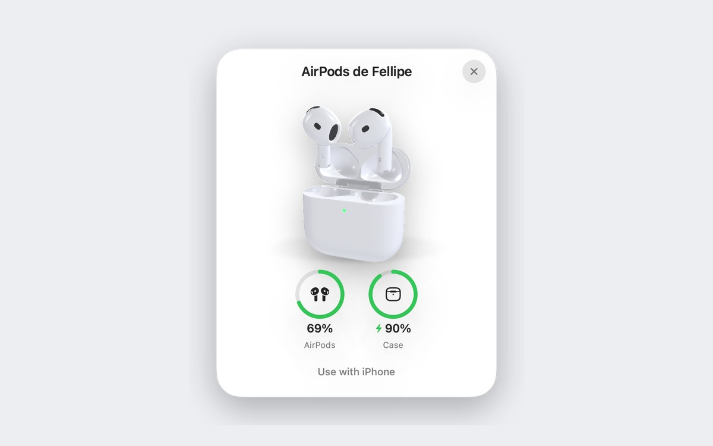
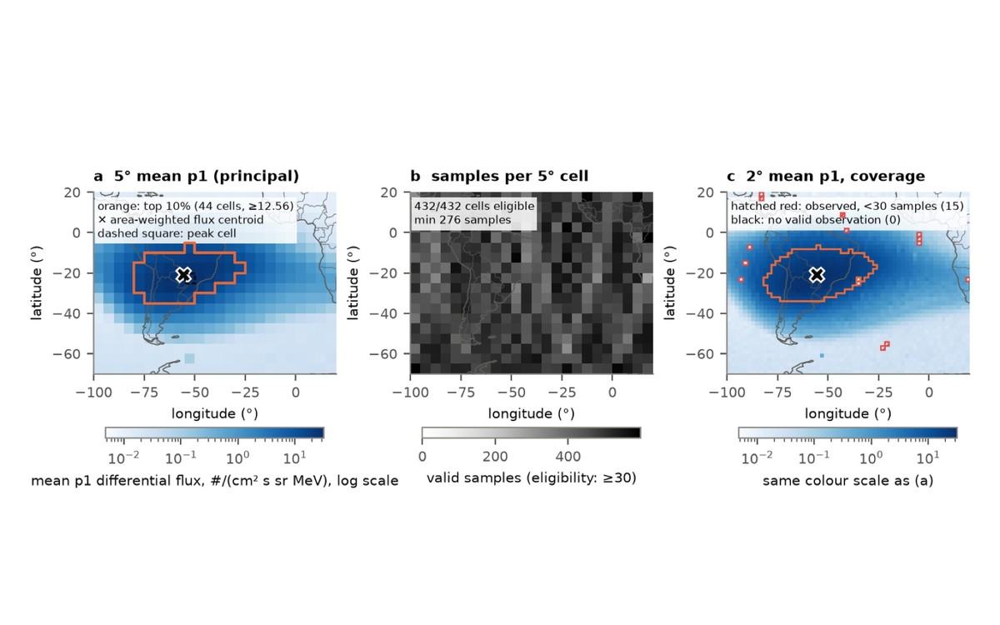

## Hi, I'm Fellipe

Student in Brazil, in the technical course in informatics at CEFET-MG. I build Mac apps in Swift, web platforms in TypeScript and data projects in Python, and I'm currently learning machine learning.

<table>
  <tr>
    <td width="50%" valign="top">
      
      
<a href="https://github.com/fellipegoncalvesleite/liquid-notch"><b>Liquid Notch</b></a> 
      The MacBook notch as a liquid, Dynamic Island-style shape for music, lyrics, AirPods and Claude Code. 
      Swift · SwiftUI · open source (MIT) · <a href="https://github.com/fellipegoncalvesleite/liquid-notch/releases/latest">Download</a>

    </td>
    <td width="50%" valign="top">
      <a href="https://airpane.app"><picture><source media="(prefers-color-scheme: dark)" srcset="images/airpane-dark.jpg"></picture></a>
      
<a href="https://airpane.app"><b>AirPane</b></a> 
      A menu bar app for AirPods: an iOS-style popup with a 3D model, battery levels and quick audio switching. 
      Swift · SwiftUI · paid app, source private · <a href="https://github.com/fellipegoncalvesleite/airpane-releases">Releases</a>

    </td>
  </tr>
  <tr>
    <td width="50%" valign="top">
      
      
<a href="https://github.com/fellipegoncalvesleite/saa-poes-mapping"><b>South Atlantic Anomaly mapping</b></a> 
      How analysis choices move a satellite-derived map of the anomaly. Reproducible; manuscript in preparation. 
      Python · NOAA POES/MetOp data · <a href="https://doi.org/10.5281/zenodo.23324359">Zenodo DOI</a>

    </td>
    <td width="50%" valign="top">
      
      
<a href="https://github.com/Brasil-Afora/brasil-afora"><b>Brasil Afora</b></a> 
      Scholarships, exchanges and olympiads for Brazilian students. Started as a group project; I'm the main developer. 
      TypeScript · Next.js · PostgreSQL

    </td>
  </tr>
</table>

**Also:** [Cresce](https://github.com/fellipegoncalvesleite/cresce) (Flutter baby-care diary, PIBIC Jr. at UFSJ) · [Nobre Amor](https://github.com/fellipegoncalvesleite/nobre-amor-baby) (online store) · [VocabSAT](https://github.com/fellipegoncalvesleite/satvocab) · [Versus Quiz](https://github.com/fellipegoncalvesleite/versus-quiz)

**Tools:** Swift · SwiftUI · Python · TypeScript · React / Next.js · PostgreSQL · Supabase · Flutter / Dart

[LinkedIn](https://www.linkedin.com/in/fellipe-leite-05a41242a/) · [Buy me a coffee on PayPal](https://www.paypal.com/ncp/payment/8ZCX7UBTXTXXN) if my free apps help you
