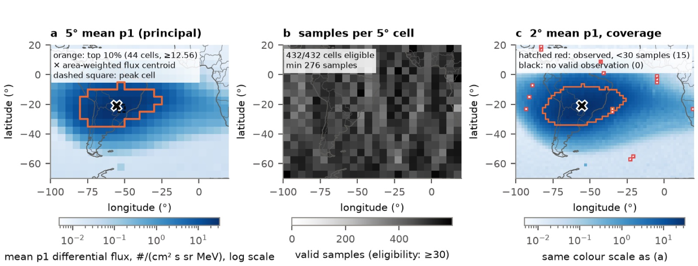

# Fellipe Gonçalves Leite

Student in Brazil, in the technical course in informatics at CEFET-MG. I build Mac apps in Swift, web platforms in TypeScript and data projects in Python, and I'm currently learning machine learning.

<table>
  <tr>
    <td width="50%" valign="top">
      
      <h3>Liquid Notch</h3>
      Open-source macOS app that turns the MacBook notch into a liquid, Dynamic Island-style shape for music, lyrics, AirPods, timers and Claude Code approvals. 
      Swift · SwiftUI · MIT 
      <a href="https://github.com/fellipegoncalvesleite/liquid-notch">Repository</a> · <a href="https://github.com/fellipegoncalvesleite/liquid-notch/releases/latest">Download</a>
    </td>
    <td width="50%" valign="top">
      
      <h3>AirPane</h3>
      Menu bar app for AirPods on the Mac: an iOS-style popup with a 3D model when you open the case, battery levels, and quick switching of the sound output or between Mac and iPhone. A paid app, so the source is private. 
      Swift · SwiftUI 
      <a href="https://airpane.app">airpane.app</a> · <a href="https://github.com/fellipegoncalvesleite/airpane-releases">Releases</a>
    </td>
  </tr>
  <tr>
    <td width="50%" valign="top">
      
      <h3>South Atlantic Anomaly mapping</h3>
      Independent study of how analysis choices move a satellite-derived map of the South Atlantic Anomaly, using NOAA POES/MetOp proton data. Fully reproducible; manuscript in preparation. 
      Python · NumPy · xarray 
      <a href="https://github.com/fellipegoncalvesleite/saa-poes-mapping">Repository</a> · <a href="https://doi.org/10.5281/zenodo.23324359">Zenodo DOI</a>
    </td>
    <td width="50%" valign="top">
      
      <h3>Brasil Afora</h3>
      Platform that curates scholarships, exchanges, olympiads and summer programs for Brazilian students. It started as a group project; I'm the main developer and finished it. 
      TypeScript · Next.js · PostgreSQL 
      <a href="https://github.com/Brasil-Afora/brasil-afora">Repository</a>
    </td>
  </tr>
</table>

**Also:** [Cresce](https://github.com/fellipegoncalvesleite/cresce) (baby-care diary in Flutter, PIBIC Jr. internship at UFSJ) · [Nobre Amor](https://github.com/fellipegoncalvesleite/nobre-amor-baby) (online store, [live](https://www.nobreamor.com)) · [VocabSAT](https://github.com/fellipegoncalvesleite/satvocab) ([play](https://satvocab-eta.vercel.app)) · [Versus Quiz](https://github.com/fellipegoncalvesleite/versus-quiz) ([play](https://versus-quiz.vercel.app))

**Tools:** Swift · SwiftUI · Python · TypeScript · React / Next.js · PostgreSQL · Supabase · Flutter / Dart · Git

**Support:** if my free apps help you, you can [buy me a coffee on PayPal](https://www.paypal.com/ncp/payment/8ZCX7UBTXTXXN).

[LinkedIn](https://www.linkedin.com/in/fellipe-leite-05a41242a/)
